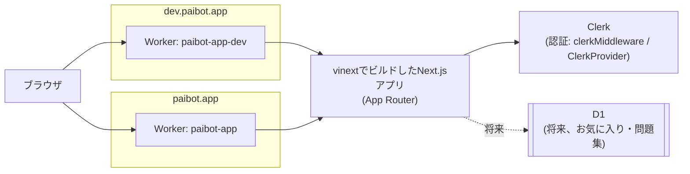
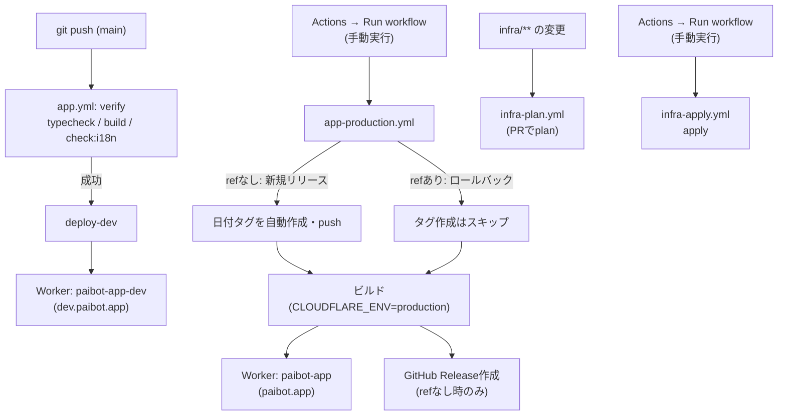

> React Router移行に伴う現在の構成は [README](../README.md) と [切り替え手順](plans/react-router-cutover.md) を参照。以下のNext.js/vinext・CI図は移行前の記録です。インフラの管理境界は引き続き有効です。

# アーキテクチャ概要

初めてこのプロジェクトに触る人向けの、全体像の入り口。各トピックの詳細は個別ドキュメントにリンクしてあるので、そちらを参照すること。ここは「何がどう繋がっているか」の地図で、手順書ではない。

## これは何か

`paibot.app`は、PAIBOT LLCが公開する小さなユーティリティツール集(IPアドレス確認、文字数カウント、パスワード生成など)+ 認証つきアカウント機能を持つWebアプリ。日本語・英語・簡体字中国語に対応。

## 技術スタックと、なぜその組み合わせか

| 層 | 使っているもの | 補足 |
| --- | --- | --- |
| フレームワーク | Next.js 16(App Router) | |
| ビルド/デプロイアダプター | [vinext](https://vinext.dev/)(beta) | 素のNext.jsではなくvinext経由でビルド・実行している。理由: D1などCloudflareバインディングに`import { env } from "cloudflare:workers"`で直接アクセスするコードがあり、素のNext.jsのビルド・開発サーバーではこの特殊モジュールを解決できないため |
| 実行環境 | Cloudflare Workers | Vercel等ではなく、Cloudflareの単一アカウント上で動く2つのWorker(`paibot-app-dev`・`paibot-app`)としてデプロイされる |
| 認証 | Clerk | 開発・本番で別インスタンス(後述) |
| 国際化 | next-intl | `ja`/`en`/`zh`、`messages/*.json`(機能ごとにネストした構造) |
| 今後使う予定 | Cloudflare D1 | まだ未導入。お気に入り機能([#18](https://github.com/paibot-hq/paibot-app/issues/18))で最初に入れる計画 |

vinextはbeta版のアダプターで、他に前例の少ない「Next.js on Cloudflare Workers」という組み合わせの接続部分にあたる。ここで実際に踏んだ罠(Clerkの`require()`問題、next-intlの二重モジュール問題、ビルド時の環境変数の扱いなど)は`CLAUDE.md`の「ビルドツール」節と`docs/plans/production-deploy.md`にまとめてある。

## リクエストの流れ

devとprodは**別々のWorker**(`paibot-app-dev`/`paibot-app`)で、`wrangler.jsonc`の`env.production`ブロックで本番用の設定(Worker名・カスタムドメインのroutes)を上書きしている。この`env.production`はビルド時に`CLOUDFLARE_ENV=production`を渡さないと反映されない(vinext build特有の仕様、詳細は`docs/plans/production-deploy.md`)。

## 認証情報・シークレットの扱い(混同しやすい)

- **Clerkの鍵**: 実際にデプロイされたWorkerが読むのは、CIの`.env.local`ステップではなく**`wrangler secret put`で設定したCloudflare Workers Secret**。`.env.local`はローカルの`wrangler dev`用の`.dev.vars`にしかならず、デプロイ後のWorkerには反映されない(これも今日発見した罠、`docs/plans/production-deploy.md`参照)。`NEXT_PUBLIC_*`はクライアントバンドルへの静的埋め込みのため`.env.local`が別途必要。
- **Clerkのインスタンス自体もdev/prodで別**: devは共有の開発用認証情報(Google等もClerkの共通キー)。本番は自分専用のGoogle OAuthクライアント(GCPの`paibot-app-prod`プロジェクトに作成)と、`clerk deploy`で作ったカスタムドメイン(`clerk.paibot.app`)を使う。

## CI/CD(GitHub Actions)

| ワークフロー | トリガー | やること |
| --- | --- | --- |
| `app.yml` | `main`へのpush/PR(`infra/**`除く) | typecheck・ビルド・`check:i18n` → 成功したら`paibot-app-dev`へ自動デプロイ |
| `app-production.yml` | 手動実行(`workflow_dispatch`)のみ | `ref`未指定なら日付タグを自動作成して新規リリース、指定ありならロールバック。承認ゲートはOrganizationのFreeプランで使えないため、手動実行そのものが確認ステップ |
| `infra-plan.yml` / `infra-apply.yml` | `infra/**`変更のPR / 手動実行 | Terraformのplan/apply(下記) |

## インフラのコード化(Terraform vs Wrangler)

同じリソースを二重管理しない、という原則で分担している。

- **Wrangler**(`wrangler.jsonc`)が管理: Worker本体、バインディング、vars、ルーティング
- **Terraform**(`infra/`)が管理: Wranglerでは管理しないアカウントレベルのCloudflareリソース。今あるのは、devのWorkerを守るCloudflare Access(`infra/access.tf`)と、Clerk本番用のDNSレコード(`infra/dns.tf`)

詳細は`infra/README.md`。

## アカウント構成

- **Cloudflare**: `Admin@paibot.co.jp's Account`が実際にpaibotのリソース(Worker、DNS等)を持つ。`sanofc@gmail.com`がメンバーとしてログイン・操作している。詳細・注意点(個人用の別Cloudflareアカウントと混同しないこと等)は`docs/infra/cloudflare.md`
- **AWS**・**GCP**: 現状のアプリ本体はどちらも使っていない。AWSはOrganization+IAM Identity Centerを整備済みだが用途未定(`docs/infra/aws.md`)。GCPは`paibot-app-prod`プロジェクトを本番Google OAuthクライアントの置き場として実際に使っている(`docs/infra/gcp.md`)
- **GitHub**: リポジトリは`paibot-hq/paibot-app`

## もっと詳しく知りたい時にどこを読むか

| 知りたいこと | 読むもの |
| --- | --- |
| 進行中の計画、ビルドツールのハマりどころ全般 | `CLAUDE.md` |
| 本番デプロイの設計・実装・発見した罠 | `docs/plans/production-deploy.md` |
| 数学問題集(未実装)の設計 | `docs/plans/problemset.md` |
| Terraformで何を管理しているか | `infra/README.md` |
| 各クラウドアカウントの管理状況 | `docs/infra/aws.md`・`gcp.md`・`cloudflare.md` |
| 新しいツールページの追加方法 | `CLAUDE.md`の「新しいツールページを追加するときの構成」 |
